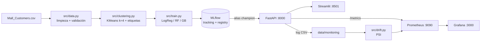
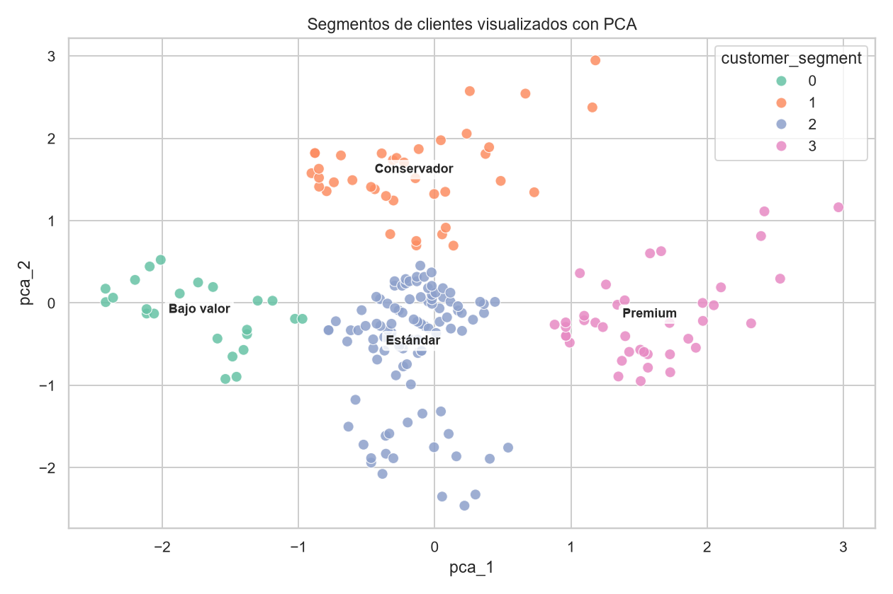

# MLOps Mall Customers · Segmentación con MLflow, FastAPI, Streamlit y Grafana

[](https://github.com/jacobounzueta/mlops-mall-customers/actions/workflows/ci.yml)


Laboratorio MLOps de punta a punta: desde un CSV de clientes hasta una API
monitoreada, un frontend y dashboards, con tracking de experimentos y registro
de modelos. Basado en el laboratorio de
[Juan Manuel Núñez Velasco](https://medium.com/@juanmanuel.nunezv/c%C3%B3mo-construir-un-proyecto-mlops-completo-con-python-mlflow-fastapi-streamlit-y-grafana-bb976068f59f),
con correcciones técnicas y extensiones de monitoreo.

> **Documento de laboratorio completo:** [`docs/INFORME.md`](docs/INFORME.md)

---

## 1. Qué resuelve

El dataset **Mall Customers** (200 clientes) no trae etiqueta. El pipeline:

1. Limpia y valida los datos.
2. Construye 4 segmentos con **KMeans** sobre ingreso y gasto.
3. Nombra cada segmento a partir de sus centroides (sin etiquetas hardcodeadas).
4. Entrena 3 clasificadores supervisados para reproducir la asignación de segmento.
5. Registra el mejor modelo en **MLflow** con el alias `champion`.
6. Lo sirve con **FastAPI** (`/predict`, `/predict/batch`, `/metrics`).
7. Lo consume desde **Streamlit**.
8. Monitorea throughput, latencia, errores y **data drift (PSI)** en **Prometheus + Grafana**.



| Servicio | URL | Credenciales |
|---|---|---|
| MLflow | http://localhost:5000 | — |
| API (Swagger) | http://localhost:8000/docs | — |
| Streamlit | http://localhost:8501 | — |
| Prometheus | http://localhost:9090 | — |
| Grafana | http://localhost:3000 | `admin` / `admin` |

---

## 2. Resultados

### Segmentos encontrados (k=4, silhouette = 0.494)

| Segmento | Etiqueta | Clientes | Edad media | Ingreso medio (k$) | Gasto medio |
|---:|---|---:|---:|---:|---:|
| 0 | Bajo valor | 23 | 45.2 | 26.3 | 20.9 |
| 1 | Conservador | 38 | 40.4 | 87.0 | 18.6 |
| 2 | Estándar | 100 | 39.2 | 48.3 | 56.5 |
| 3 | Premium | 39 | 32.7 | 86.5 | 82.1 |



### Modelos entrenados

| Modelo | Accuracy | F1 weighted | Log loss |
|---|---:|---:|---:|
| logistic_regression | 1.000 | 1.000 | 0.1335 |
| random_forest | 1.000 | 1.000 | 0.0259 |
| **gradient_boosting** (champion) | 1.000 | 1.000 | 0.0000 |

> La accuracy de 1.0 es **esperada y está documentada**: el target se deriva de
> `annual_income_k` y `spending_score`, que también son features del clasificador.
> El modelo supervisado actúa como *surrogate* del KMeans para servir más rápido,
> no como un predictor independiente. El desempate por `log_loss` sí es
> informativo. Ver limitaciones en el informe.

---

## 3. Inicio rápido

### Requisitos

- Python 3.12
- Docker Desktop con Compose v2
- `uv` (recomendado) o `pip`

### Primera ejecución (entrenar y luego levantar todo)

```bash
git clone https://github.com/jacobounzueta/mlops-mall-customers.git
cd mlops-mall-customers
cp .env.example .env

# 1) Solo el tracking server
docker compose up -d mlflow

# 2) Entorno local y pipeline
uv venv .venv --python 3.12
uv pip install --python .venv/Scripts/python.exe -r requirements.txt   # Linux/macOS: .venv/bin/python
.venv/Scripts/python.exe -m src.data
.venv/Scripts/python.exe -m src.clustering
.venv/Scripts/python.exe -m src.train
.venv/Scripts/python.exe -m src.register_model

# 3) Stack completo (API, UI, Prometheus, Grafana)
docker compose up -d --build
```

Abre `http://localhost:8501` y haz una predicción. Luego entra a Grafana:
`Dashboards → MLOps → Mall Customers · MLOps`.

> Si levantaste el stack **antes** de registrar el modelo, la API arranca en
> estado `degraded`. Ejecuta `docker compose restart api` después de registrar.

Con GNU Make: `make setup`, `make cluster`, `make train`, `make register`, `make up`.

### Modo desarrollo (sin contenedores para API/UI)

```bash
.venv/Scripts/python.exe -m uvicorn api.main:app --reload --port 8000
.venv/Scripts/python.exe -m streamlit run app/streamlit_app.py
```

Prometheus y Grafana siguen corriendo en Docker y apuntan a `api:8000`; para
scrapear la API del host, cambia el target en `docker/prometheus.yml` a
`host.docker.internal:8000`.

### Apagar y reiniciar

```bash
docker compose down          # conserva volúmenes
docker compose down -v       # borra Prometheus/Grafana
rm -rf mlflow                # borra experimentos y modelos registrados
```

---

## 4. API

| Método | Ruta | Descripción |
|---|---|---|
| `GET` | `/` | Información del servicio |
| `GET` | `/health` | Estado y versión del modelo (`ok` / `degraded`) |
| `GET` | `/model/info` | Alias, versión, run, segmentos y medias globales |
| `POST` | `/predict` | Predicción individual |
| `POST` | `/predict/batch` | Hasta 100 clientes por request |
| `GET` | `/predictions/recent` | Últimas predicciones registradas |
| `GET` | `/metrics` | Métricas Prometheus |

```bash
curl -X POST http://localhost:8000/predict \
  -H "Content-Type: application/json" \
  -d '{"gender":"Female","age":24,"annual_income_k":90,"spending_score":85}'
```

```json
{
  "customer_segment": 3,
  "segment_label": "Premium",
  "segment_description": "Ingreso alto y gasto alto. El segmento de mayor valor.",
  "probabilities": {"0": 0.0, "1": 0.0, "2": 0.002, "3": 0.998},
  "model_name": "mall-customer-segment-classifier",
  "model_version": "1",
  "latency_ms": 3.14,
  "timestamp": "2026-11-26T01:20:00+00:00"
}
```

Validación con Pydantic: `gender ∈ {Male, Female}`, `18 ≤ age ≤ 100`,
`0 ≤ annual_income_k ≤ 200`, `1 ≤ spending_score ≤ 100`. Un request inválido
devuelve `422` y suma al contador de errores.

---

## 5. Observabilidad

Métricas expuestas por la API:

| Métrica | Tipo | Uso |
|---|---|---|
| `mall_customer_predictions_total{segment,label}` | Counter | Volumen por segmento |
| `mall_customer_prediction_latency_seconds` | Histogram | p50 / p95 |
| `mall_customer_prediction_errors_total{reason}` | Counter | Validación e inferencia |
| `mall_customer_feature_psi{feature}` | Gauge | Data drift vs entrenamiento |
| `mall_customer_drift_samples` | Gauge | Muestras usadas para el PSI |
| `mall_customer_model_loaded` | Gauge | Salud del modelo |
| `mall_customer_http_requests_total{endpoint,status_code}` | Counter | Tráfico HTTP |

Consultas de ejemplo en Prometheus:

```promql
sum(rate(mall_customer_predictions_total[1m]))
histogram_quantile(0.95, sum by (le) (rate(mall_customer_prediction_latency_seconds_bucket[5m])))
sum by (label) (mall_customer_predictions_total)
mall_customer_feature_psi
```

El dashboard se aprovisiona como código (`docker/grafana/`), sin clics manuales.
El PSI se publica solo a partir de 30 predicciones (`MIN_DRIFT_SAMPLES`), porque
con muestras pequeñas es estadísticamente inestable. Para recalcular el drift
desde la CLI: `make drift`.

---

## 6. Calidad

```bash
ruff check src api app tests scripts
pytest
```

- 28 tests: datos, features, etiquetas, PSI y API (con modelo simulado, sin MLflow).
- `make smoke` valida la API desplegada y guarda evidencia en
  `reports/metrics/smoke_test.json` (8/8 checks).
- `make traffic` genera 120 predicciones de demostración para poblar Grafana y
  habilitar el PSI.
- CI en GitHub Actions: lint + tests, pipeline de datos/clustering y build de la
  imagen Docker.
- Dataset crudo versionado para que el CI sea reproducible sin descargas externas.
- Dependencias directas pinneadas en `requirements.txt` y el árbol completo en
  `requirements.lock` (112 paquetes, generado en Windows) para reconstruir el
  entorno exacto.

### Verificación end-to-end (local)

| Check | Resultado |
|---|---|
| `/health` | `ok`, versión 1, alias `champion` |
| `/predict` | segmento 3 · Premium · ~3 ms |
| Prometheus target | `UP` |
| Latencia p95 | 4.79 ms |
| PSI (126 muestras) | 0.0001 – 0.0305 → estable |
| Grafana | dashboard de 10 paneles con datos |
| `scripts/smoke_test.py` | 8/8 OK |

---

## 7. Estructura

```text
.
├── api/main.py                 # FastAPI + métricas + logging de predicciones
├── app/streamlit_app.py        # Frontend que consume la API
├── src/
│   ├── config.py               # Configuración centralizada (env-overridable)
│   ├── data.py                 # Descarga, limpieza y validación
│   ├── features.py             # Contrato de features
│   ├── clustering.py           # KMeans, PCA, etiquetas de negocio
│   ├── train.py                # 3 modelos + tracking MLflow
│   ├── register_model.py       # Mejor modelo + alias champion
│   ├── predict.py              # Prueba local con pyfunc
│   └── drift.py                # PSI y reporte de drift
├── docker/
│   ├── Dockerfile              # Multi-stage (api / streamlit)
│   ├── prometheus.yml
│   └── grafana/                # Datasource + dashboard como código
├── scripts/smoke_test.py       # Prueba E2E contra la API desplegada
├── tests/
├── docs/INFORME.md
├── docker-compose.yml
├── Makefile
├── requirements.txt
└── requirements.lock           # freeze completo del entorno verificado
```

---

## 8. Decisiones que mejoran el artículo original

| Problema del tutorial | Solución aplicada |
|---|---|
| `log_model(artifact_path=...)` deprecado en MLflow 3 | `name="model"` |
| Registry con store en memoria | SQLite + `--serve-artifacts` (artefactos vía HTTP) |
| MLflow 3 rechaza el Host interno de Compose (403) | `--allowed-hosts=mlflow:5000,...` |
| `@app.on_event("startup")` deprecado | `lifespan` + carga tolerante a fallos |
| Clustering con `gender` → clusters separados por género (silhouette 0.298) | Clustering conductual (ingreso + gasto), silhouette 0.494 |
| Etiquetas de negocio hardcodeadas e incorrectas | Etiquetas derivadas de los centroides (JSON versionado) |
| `datetime.utcnow()` deprecado | `datetime.now(UTC)` |
| Queries de Grafana con nombres de métrica incorrectos | Nombres verificados contra `/metrics` |
| CI dependía de un CSV ausente | Dataset versionado + check de artefactos |
| Dashboard creado a mano | Aprovisionado como código |
| Dependencias sin versión | `requirements.txt` pinneado |

---

## 9. Limitaciones y trabajo futuro

- El target deriva de features de entrada → accuracy trivial. Próximo paso:
  definir segmentos con criterios de negocio o usar datos temporales reales.
- `gradient_boosting` es champion por `log_loss = 0`, señal de sobreconfianza;
  conviene calibrar (`CalibratedClassifierCV`) y monitorear calibración.
- El drift es de **covariables**, no de desempeño (no hay ground truth en línea).
- Registry en SQLite: adecuado para laboratorio, no para múltiples réplicas
  (migrar a PostgreSQL).
- Sin autenticación, TLS ni límites de tasa en la API pública.
- Posibles extensiones: Evidently para reportes de drift, alertas en Grafana,
  despliegue canary con alias `challenger`, publicación de imágenes en GHCR.

---

## 10. Autores

- **Jacobo Unzueta** — [@jacobounzueta](https://github.com/jacobounzueta) · jacobo.unzueta@uao.edu.co
- **Rommel Prieto** — [@stiwardprieto](https://github.com/stiwardprieto) · rommel.prieto@uao.edu.co

Licencia MIT. Ver [`LICENSE`](LICENSE).
