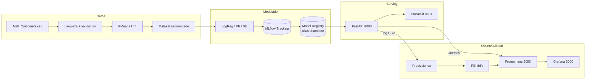
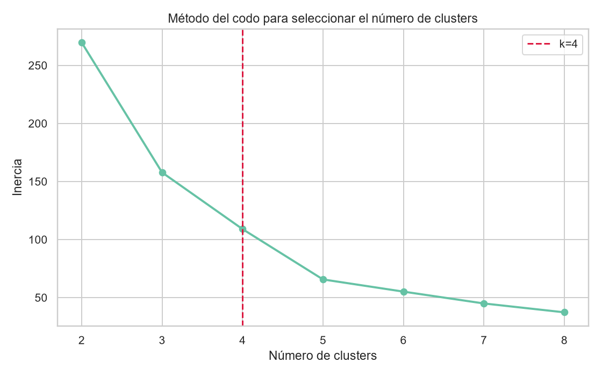
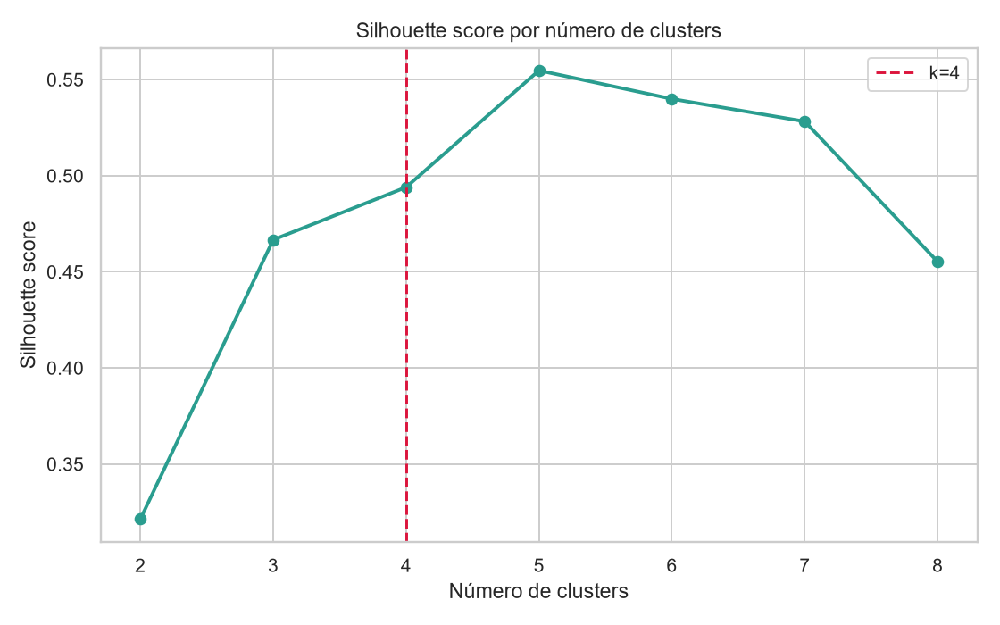
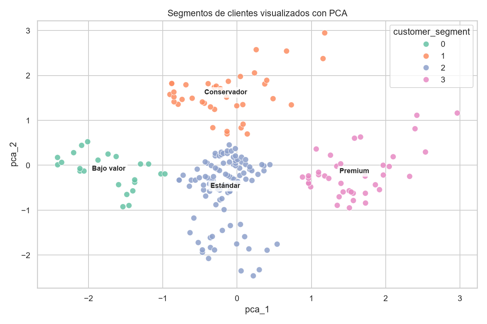
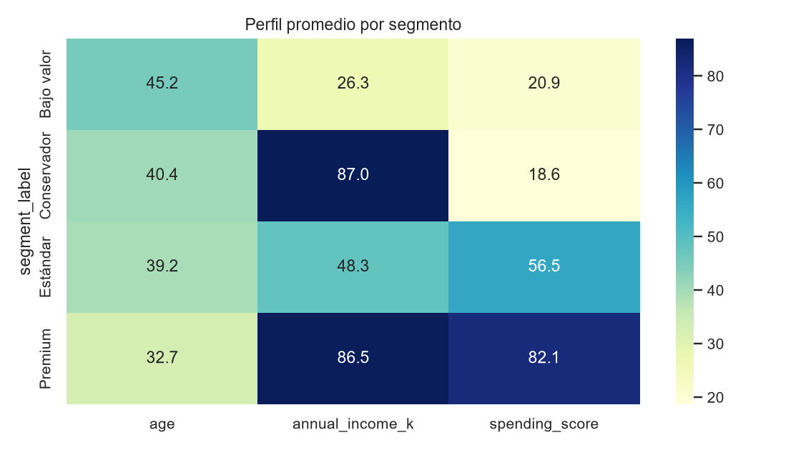
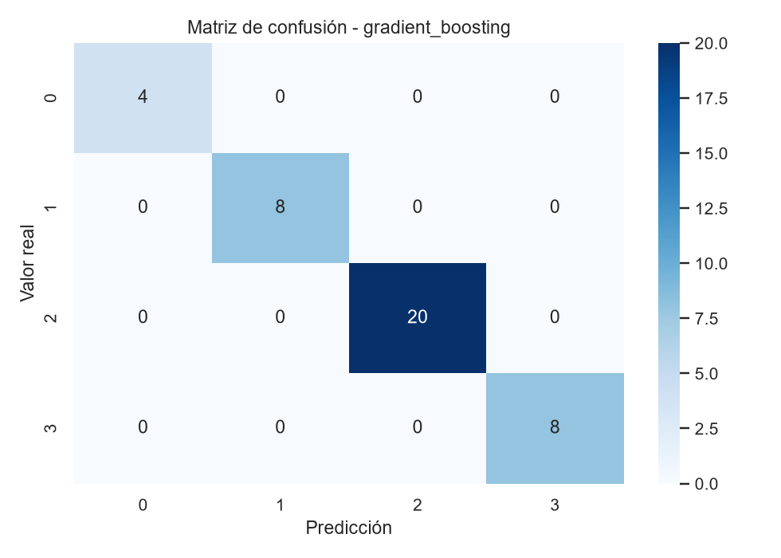

# Informe de laboratorio: proyecto MLOps de segmentación de clientes

**Título:** Construcción de un pipeline MLOps completo con Python, MLflow,
FastAPI, Streamlit, Prometheus y Grafana

**Autores:** Jacobo Unzueta y Rommel Prieto

**Asignatura:** Gestión de Proyectos de IA

**Fecha:** 25 de noviembre de 2026

**Repositorio:** <https://github.com/jacobounzueta/mlops-mall-customers>

---

## 1. Resumen ejecutivo

Se implementó un flujo MLOps de extremo a extremo sobre el dataset **Mall
Customers** (200 clientes, 4 variables). El pipeline descarga y valida los
datos, construye cuatro segmentos con KMeans, entrena tres clasificadores
supervisados, registra el mejor en MLflow con el alias `champion` y lo sirve a
través de una API FastAPI consumida por un frontend Streamlit. Todo el sistema
se monitorea con Prometheus y Grafana, incluido un indicador de **data drift**
(PSI) calculado con las predicciones reales.

El resultado es un sistema reproducible de un solo comando (`docker compose up
-d --build`), con 28 pruebas automatizadas, integración continua en GitHub
Actions y un dashboard aprovisionado como código. El proyecto corrige varios
problemas del tutorial de referencia y documenta dos hallazgos metodológicos:
(i) incluir `gender` en el clustering produce segmentos determinados por género,
y (ii) el clasificador supervisado reproduce las fronteras del KMeans, por lo
que su accuracy de 1.0 debe interpretarse como *surrogate modeling* y no como
capacidad predictiva real.

---

## 2. Objetivos

### Objetivo general

Construir y desplegar un proyecto MLOps completo, reproducible y monitoreado,
que cubra el ciclo de vida de un modelo de machine learning.

### Objetivos específicos

1. Implementar un pipeline de ingesta, limpieza y validación de datos.
2. Segmentar clientes con KMeans y nombrar los segmentos a partir de sus
   centroides.
3. Entrenar y comparar al menos tres modelos supervisados.
4. Versionar experimentos, métricas, artefactos y modelos con MLflow.
5. Exponer el modelo como servicio REST con FastAPI.
6. Construir una interfaz de usuario con Streamlit.
7. Instrumentar métricas de negocio, latencia y errores con Prometheus y
   Grafana.
8. Automatizar pruebas, lint y build con GitHub Actions.
9. Documentar decisiones, resultados y limitaciones.

---

## 3. Marco conceptual

- **MLOps**: conjunto de prácticas que integran desarrollo, despliegue y
  operación de modelos de machine learning, buscando reproducibilidad y
  trazabilidad.
- **KMeans**: algoritmo de clustering que particiona observaciones en *k*
  grupos minimizando la inercia intra-cluster.
- **Silhouette score**: medida de cohesión y separación de los clusters
  (rango −1 a 1; valores mayores indican mejor estructura).
- **MLflow**: plataforma de tracking de experimentos, empaquetado y registro de
  modelos. Se usa el *Model Registry* con alias (`champion`) en lugar de etapas
  obsoletas.
- **FastAPI**: framework ASGI para APIs tipadas con validación Pydantic.
- **Prometheus**: sistema de métricas pull-based con modelo de series temporales.
- **Grafana**: capa de visualización y alertado sobre Prometheus.
- **PSI (Population Stability Index)**: mide el cambio de distribución de una
  variable entre referencia (entrenamiento) y producción.

---

## 4. Arquitectura



### Componentes y puertos

| Componente | Tecnología | Puerto | Persistencia |
|---|---|---|---|
| Tracking + Registry | MLflow 3.18 | 5000 | `./mlflow` (SQLite + artefactos) |
| API | FastAPI + Uvicorn | 8000 | `data/monitoring` (CSV) |
| Frontend | Streamlit | 8501 | — |
| Métricas | Prometheus 3.16 | 9090 | volumen `prometheus-data` |
| Dashboards | Grafana 12.4 | 3000 | volumen `grafana-data` |

### Decisiones de diseño

1. **Un solo contrato de configuración** (`src/config.py`) con sobrescritura por
   variables de entorno, para que el mismo código corra en local y en Docker.
2. **MLflow con SQLite y `--serve-artifacts`**: el registry con alias requiere
   un backend persistente; además, servir artefactos por HTTP permite que el
   contenedor de la API descargue el modelo sin rutas locales compartidas.
3. **Clustering conductual**: se excluyó `gender` del KMeans (ver sección 7.1).
4. **Etiquetas derivadas de datos**: los nombres de segmento se calculan con
   z-scores de los centroides y se guardan en `segment_labels.json`, evitando
   etiquetas hardcodeadas que no correspondan con los datos.
5. **API tolerante a fallos**: si MLflow no está disponible, la API arranca en
   estado `degraded` en lugar de fallar; `/predict` responde `503`.
6. **Observabilidad como código**: datasource y dashboard de Grafana se
   aprovisionan desde archivos versionados.
7. **Dos formas de cargar el modelo**: pyfunc en `src/predict.py` (portabilidad)
   y flavor sklearn en la API (permite `predict_proba` para mostrar confianza).

---

## 5. Metodología y desarrollo

| Fase | Actividad | Entregable |
|---|---|---|
| 0 | Entorno, dependencias pinneadas, `.gitignore`, Makefile | `requirements.txt`, `.venv` |
| 1 | Ingesta, limpieza, validación y calidad | `data/processed/*.csv`, `data_quality.json` |
| 2 | Segmentación, codo, silhouette, PCA | 4 figuras, `segment_labels.json` |
| 3 | Tracking de 3 modelos con MLflow | 3 runs en el experimento |
| 4 | Registro del mejor modelo | versión 1 + alias `champion` |
| 5 | API FastAPI con métricas y logging | `api/main.py`, Swagger |
| 6 | Frontend Streamlit | `app/streamlit_app.py` |
| 7 | Prometheus + Grafana como código | dashboard `mall-customers` |
| 8 | Tests, lint, CI, informe | 28 tests, workflow CI |

### 5.1 Datos

El CSV se versiona en `data/raw/Mall_Customers.csv` para que el CI no dependa
de la red. La limpieza normaliza encabezados a `snake_case`, elimina
`CustomerID`, verifica rangos de negocio y codifica `gender` como 0/1.

| Métrica de calidad | Valor |
|---|---|
| Registros | 200 |
| Nulos | 0 |
| Duplicados | 0 |
| Edad | 18–70 (media 38.85) |
| Ingreso anual (k$) | 15–137 (media 60.56) |
| Spending score | 1–99 (media 50.2) |
| Distribución de género | 56 % F / 44 % M |

### 5.2 Segmentación

Se evaluaron `k = 2..8` con inercia y silhouette. Se mantuvo `k=4` para
conservar el alcance del laboratorio, aunque `k=5` obtiene un silhouette algo
mayor (0.555 vs 0.494); con `k=4` los segmentos son cuadrantes de negocio
interpretables.

```bash
python -m src.data
python -m src.clustering
```





| Segmento | Etiqueta | Clientes | Edad | Ingreso (k$) | Gasto |
|---:|---|---:|---:|---:|---:|
| 0 | Bajo valor | 23 | 45.2 | 26.3 | 20.9 |
| 1 | Conservador | 38 | 40.4 | 87.0 | 18.6 |
| 2 | Estándar | 100 | 39.2 | 48.3 | 56.5 |
| 3 | Premium | 39 | 32.7 | 86.5 | 82.1 |





### 5.3 Entrenamiento y tracking

```bash
docker compose up -d mlflow
python -m src.train
```

Cada run registra parámetros, tags (commit, filas, número de clusters),
métricas, matriz de confusión, reporte de clasificación, esquema y el modelo
con firma e `input_example`. Los artefactos del modelo se serializan con
cloudpickle para mantener compatibilidad con los árboles de decisión.

| Modelo | Accuracy | Precision | Recall | F1 weighted | Log loss |
|---|---:|---:|---:|---:|---:|
| Logistic Regression | 1.000 | 1.000 | 1.000 | 1.000 | 0.1335 |
| Random Forest | 1.000 | 1.000 | 1.000 | 1.000 | 0.0259 |
| Gradient Boosting | 1.000 | 1.000 | 1.000 | 1.000 | 0.0000 |



### 5.4 Registro y serving

```bash
python -m src.register_model
python -m src.predict --gender Female --age 24 --income 90 --spending 85
```

Resultado del registro: versión **1** del modelo
`mall-customer-segment-classifier`, alias `champion`, run
`281bfd1a13c8435799609727d9095734`. La predicción de prueba devuelve el
segmento **3 (Premium)**.

La API se levanta con el stack completo:

```bash
docker compose up -d --build
```

### 5.5 Observabilidad

La API expone contadores, histograma de latencia, errores por motivo, estado del
modelo y PSI por variable. Cada predicción se escribe en
`data/monitoring/api_predictions_log.csv`. El endpoint `/metrics` recalcula el
PSI contra la distribución de entrenamiento y actualiza los gauges que consume
Prometheus cada 5 segundos. Para evitar conclusiones con muestras pequeñas, el
PSI solo se publica a partir de 30 predicciones (`MIN_DRIFT_SAMPLES`) y se
expone `mall_customer_drift_samples` con el tamaño de muestra usado. El script
`scripts/generate_traffic.py` genera tráfico de demostración con clientes reales
del dataset.

El dashboard `Mall Customers · MLOps` incluye 10 paneles: predicciones totales,
throughput, errores, estado del modelo, latencia p50/p95, distribución por
segmento, participación de segmentos, PSI y tasa de errores.

### 5.6 Pruebas y CI

```bash
ruff check src api app tests
pytest
```

Resultado: **28 tests aprobados** y lint sin errores. La suite cubre:

- Contrato y calidad del dataset, incluyendo casos inválidos.
- Orden de features y estandarización.
- Etiquetas de segmento y unicidad.
- PSI: distribuciones iguales, shift severo y estabilidad.
- API: raíz, health, predicción, validación 422, 503 sin modelo, batch,
  historial y métricas Prometheus.

El workflow de GitHub Actions ejecuta tres jobs: calidad (lint + tests),
pipeline (datos + clustering + verificación de artefactos) y build de la imagen
Docker de la API. Los tres se ejecutaron en verde sobre `main`; el historial está
en <https://github.com/jacobounzueta/mlops-mall-customers/actions>.

---

## 6. Evidencias de ejecución

| Evidencia | Resultado |
|---|---|
| `GET /health` | `status: ok`, modelo versión 1, alias `champion` |
| `POST /predict` (Female, 24, 90, 85) | segmento 3, etiqueta Premium, ~3 ms |
| `POST /predict/batch` (25 clientes) | 200, 25 predicciones |
| `GET /predictions/recent` | predicciones con timestamp, etiqueta y latencia |
| Prometheus target `mall-customers-api` | `UP` |
| `mall_customer_model_loaded` | `1` |
| Latencia p95 (ventana 5 min) | 4.79 ms |
| 120 predicciones de demostración | Estándar 56, Conservador 24, Premium 22, Bajo valor 18 |
| PSI con 126 muestras | gender 0.0001, age 0.0305, income 0.0276, spending 0.0267 (estable) |
| Grafana dashboard | 10 paneles con datos, datasource Prometheus OK |
| `pytest` | 28 passed |
| `ruff check` / `ruff format --check` | All checks passed |
| `scripts/smoke_test.py` | 8/8 checks OK (`reports/metrics/smoke_test.json`) |

Las figuras del pipeline se adjuntan en `reports/figures/`; las métricas y
reportes en `reports/metrics/`.

---

## 7. Análisis crítico

### 7.1 El género dominaba el clustering

La primera implementación siguió el tutorial y clusterizó con las cuatro
variables. El resultado fue una separación perfecta por género:

| Cluster | Mujeres | Hombres |
|---|---:|---:|
| 0 | 56 | 0 |
| 1 | 0 | 46 |
| 2 | 56 | 0 |
| 3 | 0 | 42 |

silhouette = 0.298. Los "segmentos" no describían comportamiento sino género, y
el clasificador posterior aprendía una regla trivial. Se excluyó `gender` del
KMeans (se mantiene como feature del clasificador) y el silhouette subió a
0.494 con segmentos interpretables de ingreso/gasto. Es un ejemplo de por qué
las decisiones de features en clustering requieren inspección de centroides y
no solo métricas.

### 7.2 Accuracy de 1.0 y circularidad

El target (`customer_segment`) se deriva de `annual_income_k` y
`spending_score`, que también entran al clasificador. Por construcción, las
fronteras son aprendibles y la accuracy es 1.0. El clasificador funciona como
*modelo sustituto* del KMeans: permite servir con un artefacto supervisado,
exponer probabilidades y monitorear deriva, pero no demuestra capacidad
predictiva sobre clientes nuevos. Para un caso real se requeriría una etiqueta
externa (conversión, churn, valor de vida) o datos temporales.

### 7.3 Sobreconfianza del modelo campeón

Gradient Boosting obtiene `log_loss = 0.0`: probabilidades prácticamente
binarias. Aunque el desempate por log loss es correcto, un valor exactamente
cero indica sobreajuste a las fronteras. Se recomienda calibración
(`CalibratedClassifierCV`) y monitoreo de calibración antes de usar las
probabilidades para decisiones de negocio.

### 7.4 Drift de covariables, no de desempeño

El PSI detecta cambios en la distribución de entradas, pero no mide si las
predicciones siguen siendo correctas, porque no hay ground truth en línea. El
monitoreo de desempeño requiere un proceso de etiquetado posterior (por ejemplo,
conversión a 30 días) y un job que calcule métricas diferidas.

---

## 8. Dificultades y soluciones

| Dificultad | Causa | Solución |
|---|---|---|
| `UnicodeEncodeError` al cerrar runs | Consola Windows cp1252 y emojis de MLflow | `sys.stdout.reconfigure(encoding="utf-8")` |
| `skops` rechazaba árboles | Serialización segura por defecto en MLflow 3 | `serialization_format="cloudpickle"` |
| Registry sin artefactos locales | Store en memoria / rutas locales | SQLite + `--serve-artifacts` |
| Contenedor API sin modelo | API arranca antes del registro | `depends_on` + reintentos + `restart` |
| MLflow respondía 403 desde la API | Validación de `Host` anti DNS rebinding | `--allowed-hosts=mlflow:5000` |
| Prometheus no veía la API | Target incorrecto (`host.docker.internal`) | Target `api:8000` en la red de Compose |
| Nombres de métricas distintos | `prometheus_client` agrega sufijos | Verificación contra `/metrics` y dashboard |
| Encoding del CSV | Caracteres especiales en encabezados | Normalización a `snake_case` sin `$` |
| CI sin dataset | `.gitignore` excluía el CSV | Dataset crudo versionado |

---

## 9. Conclusiones

1. Se completó el ciclo MLOps: datos, entrenamiento, registro, serving,
   frontend, monitoreo y CI, con un stack reproducible en Docker.
2. MLflow aporta trazabilidad real: cada modelo queda asociado a métricas,
   artefactos, commit y versión, y el alias `champion` desacopla el serving del
   número de versión.
3. La observabilidad con Prometheus y Grafana permitió exponer no solo
   infraestructura (latencia, errores) sino también señales de negocio
   (distribución de segmentos) y de datos (PSI).
4. El análisis crítico fue tan importante como la implementación: el clustering
   inicial estaba dominado por género y el clasificador es circular por diseño.
   Detectar y documentar ambos sesgos es parte del trabajo profesional.
5. La automatización (tests, lint, CI, dashboard como código) reduce el riesgo
   de regresiones y hace que el laboratorio sea defendible y reutilizable.

---

## 10. Trabajo futuro

- Sustituir el target derivado por una etiqueta de negocio real.
- Evaluar `k` con criterios de negocio además de silhouette (k=5 es mejor
  métricamente).
- Calibrar probabilidades y agregar monitoreo de calibración.
- Migrar el backend de MLflow a PostgreSQL para soportar varias réplicas.
- Incorporar Evidently para reportes de drift y alertas en Grafana.
- Añadir autenticación, TLS y rate limiting en la API.
- Implementar despliegue canary con alias `challenger` y promoción automática.
- Publicar imágenes en GHCR y desplegar en un entorno cloud.

---

## 11. Referencias

1. Núñez Velasco, J. M. (2026). *Cómo construir un proyecto MLOps completo con
   Python, MLflow, FastAPI, Streamlit y Grafana*. Medium.
2. MLflow Documentation. <https://mlflow.org/docs/latest/>
3. FastAPI Documentation. <https://fastapi.tiangolo.com/>
4. Streamlit Documentation. <https://docs.streamlit.io/>
5. Prometheus Documentation. <https://prometheus.io/docs/>
6. Grafana Provisioning. <https://grafana.com/docs/grafana/latest/administration/provisioning/>
7. scikit-learn: KMeans and silhouette analysis.
   <https://scikit-learn.org/stable/modules/clustering.html>
8. Dataset Mall Customers.
   <https://www.kaggle.com/datasets/vjchoudhary7/customer-segmentation-tutorial-in-python>

---

## 12. Anexos

### A. Comandos principales

```bash
make setup        # entorno + dependencias
make data         # descarga y limpieza
make cluster      # segmentación
make mlflow-up    # tracking server
make train        # 3 modelos
make register     # champion
make up           # stack completo
make test         # pytest
make lint         # ruff
make drift        # PSI desde la CLI
make traffic      # 120 predicciones de demostración
```

### B. Contrato de la API

```json
{
  "gender": "Female",
  "age": 24,
  "annual_income_k": 90,
  "spending_score": 85
}
```

```json
{
  "customer_segment": 3,
  "segment_label": "Premium",
  "segment_description": "Ingreso alto y gasto alto. El segmento de mayor valor.",
  "probabilities": {"0": 0.0, "1": 0.0, "2": 0.002, "3": 0.998},
  "model_name": "mall-customer-segment-classifier",
  "model_version": "1",
  "latency_ms": 3.14,
  "timestamp": "2026-11-26T01:20:00+00:00"
}
```

### C. Estructura del repositorio

```text
api/main.py              FastAPI, métricas, logging
app/streamlit_app.py     Frontend
src/config.py            Configuración central
src/data.py              Ingesta y validación
src/features.py          Features del modelo
src/clustering.py        KMeans, PCA, etiquetas
src/train.py             Entrenamiento + MLflow
src/register_model.py    Registro y alias
src/predict.py           Prueba local pyfunc
src/drift.py             PSI
tests/                   28 pruebas
docker/                  Dockerfile, Prometheus, Grafana
docs/INFORME.md          Este documento
```
